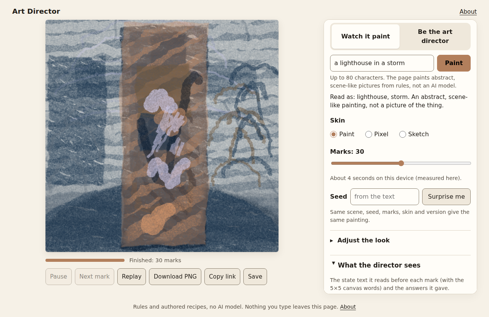
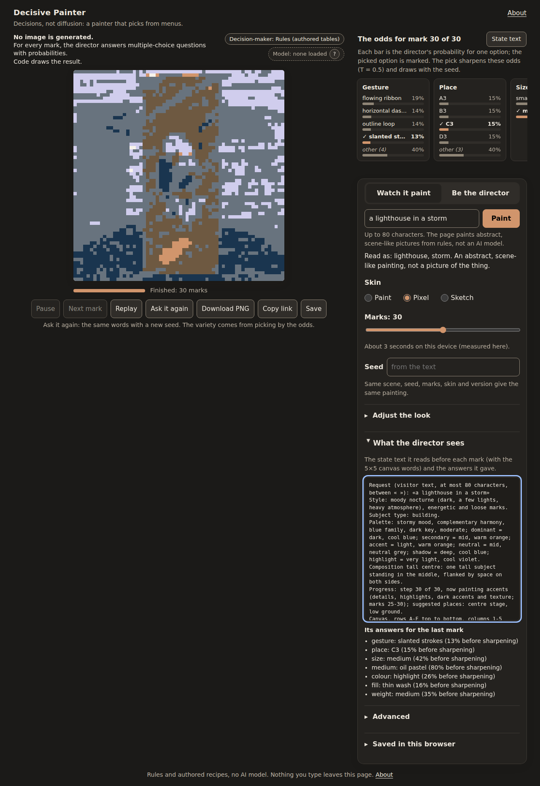

# Decisive Painter

*Decisions, not diffusion: a painter that picks from menus.*

Type a scene, such as "a lighthouse in a storm", and watch it painted mark by mark. Before every mark an "art director"
harness writes a short text state (the request, the look, the progress, a 5x5 grid of words read back from the real
pixels) and asks a **Director** a few typed questions: which mark, where, which colour, how heavy. A seeded renderer
then draws the answer. The default Director is **rules plus authored recipes: there is no AI model inside unless you load the
optional Model mode** (below), and the
paintings are abstract and scene-like, not pictures of the thing. The Director is a small interface, so a model
(for example a WebGPU model in the browser, or your own server) can be plugged in without changing the page or the
renderer. The page is plain HTML, CSS and ES modules, about 190 KB, with no build step, no analytics and no cookies, and no
third-party scripts until Model mode loads its vendored copy of transformers.js after the click.





## Run it locally

```sh
git clone https://github.com/IvanFengJK/decisive-painter.git
cd decisive-painter/web
python3 -m http.server 8000
# open http://localhost:8000/
```

Any static server works. Opening `index.html` from the file system does not, because browsers do not load ES modules
from `file://` URLs.

## Deploy to Vercel

It is a static project with nothing to build.

- Command line, from the root of a clone of `https://github.com/IvanFengJK/decisive-painter.git`: `vercel link` (once), then `vercel deploy web` (a preview), then
  `vercel deploy web --prod`.
- Dashboard: import the repository `https://github.com/IvanFengJK/decisive-painter.git` and set **Framework preset: Other**, **Build command: empty**, **Output directory:
  `web`** (or set the Root Directory to `web`).

`web/vercel.json` adds a few security headers. The Content-Security-Policy is a `<meta>` tag in the page, so it works
on any static host.

## Tests

Node 22 or newer. From the repository root:

```sh
node --test tests/*.test.mjs          # Director contract, guardrails, share links, determinism (node only, seconds)
node tests/guard-eval.mjs heldout     # guardrail lists on a test set: dev, heldout or heldout2
node tests/browser.mjs                # headless Chromium: screenshots, layout, determinism, share links, network,
                                      # CSP, offline, speed, accessibility (about 5 minutes; writes out/)
```

`tests/browser.mjs` drives an installed Chromium over the DevTools protocol, with no npm packages. It looks in the
Playwright browser cache; set `CHROME=/path/to/chrome` to use another Chromium.

The Python reference renderer that the site's renderer was ported from is in `harness/`:

```sh
pip install -r harness/requirements.txt
python harness/render_decisions.py harness/example-decisions.json example.png            # portable RNG, like the site
python harness/render_decisions.py harness/example-decisions.json frozen.png --frozen   # the original renderer
```

## Decisions, not diffusion

A **typed-question decision model** reads a short text and answers questions of three kinds: *choice* (one option from
a list), *yes/no*, and *score* (a level on a scale). For each question it gives a probability for every option, all
from one pass over the text. Code then picks an option from those odds and does the drawing.

Decisive Painter uses that shape because every decision is small, named and checkable. The odds panel under the painting
shows the probabilities for every question of every mark and marks the option that was picked.

A diffusion model works differently: it generates the pixels of an image. Here **no pixels are generated by a model**.
Every mark is a recorded choice from fixed menus, drawn by a seeded renderer, so any painting can be replayed exactly
from its choices. That is what share links and Replay do.

**The model slot is empty today: a rules table makes the choices.** The Director interface is where a model plugs in,
and the badge above the painting names whatever is deciding ("Decision-maker: Rules (authored tables)", "Model: none
loaded").

## Model mode (optional)

Press **Load model** to download a general small language model, **Qwen3-0.6B** (ONNX build `onnx-community/Qwen3-0.6B-ONNX`,
Apache-2.0). It is about 650 MB on WebAssembly (int8) or about 600 MB on WebGPU (q4f16), and it runs in the tab with the
vendored transformers.js 4.3.1. It answers the **six upfront recipe questions** (mood, harmony, hue family, value key,
saturation, composition) from the visitor's words. Each option is scored by its letter's next-token probability, with
both option orders averaged, the page's temperature applied, and no option allowed above 0.85. The per-mark choices stay
with the rules.

- It is a general model scoring the options, **not a trained decision model**, and the badge says so.
- The default page still makes **no network requests**. The download starts only after the click, and the visitor's
  words never leave the tab.
- If it cannot load, the page says why and keeps Rules on.
- The details and the CSP changes are in [docs/DIRECTOR.md](docs/DIRECTOR.md).

Whether it picks better recipes than the rules is an open question; see the quality sheet in the project notes.

## How it works

- On the page: a three-line explainer and the decision-maker badge above the canvas; the odds panel under it (one card per
  question, the top four options plus "other", the picked one marked; "State text" opens what the director reads);
  "Ask it again" repaints the same words with a new seed, so only the seeded picks from the same odds change.
- `web/director.js`: the Director interface, answer validation, the harness loop and the RuleDirector. Contracts and
  examples are in [docs/DIRECTOR.md](docs/DIRECTOR.md); the harness is specified in
  [docs/harness-spec.md](docs/harness-spec.md).
- `web/recipes.js`: about 60 authored scene recipes and a parser for generic words. An unknown scene gets an honest
  message and a look picked from a hash of the text, which the visitor can change.
- `web/render.js`: a software rasteriser, so the same scene, seed, marks and skin give the same pixels in every browser.
  Share links carry only option numbers (no text).
- Three skins: Paint, Pixel and Sketch. "Be the director" mode lets the visitor answer the questions.
- Choices and their reasons: [docs/DECISIONS.md](docs/DECISIONS.md). How the project got here:
  [docs/HISTORY.md](docs/HISTORY.md).

## Guardrails

The text box accepts short scene descriptions only.

- **L0, hygiene:** Unicode normalisation, invisible and direction characters removed, no markup, at most 80 characters.
- **L1, policy lists:** sexual content, minors, violence, hate, self-harm and private people, matched across look-alike
  letters, leetspeak, spaced-out letters and repeats.
- **L2:** one neutral message for every block.
- **L3:** a slot for a guard model. It can only add blocks and fails closed. It is off on the live page.
- **L4:** the text reaches the Director only as one delimited field.
- **L5:** clamped numbers and debounced buttons.

Measured blind on two fresh held-out sets (each committed before it was run): **0% false positives** (no benign prompt
blocked: 0 of 60 and 0 of 30) and **about 3% false negatives** (2 of 60 and 1 of 30 harmful prompts missed). Those
misses were fixed afterwards, so every set now passes, but that is not a new measurement: the blind figures above are the
honest estimate. The wordlist is not perfect. Nothing typed leaves the page unless the visitor turns on "My own
endpoint" under Advanced, which shows a warning.

## Limits

- The paintings are abstract by design: colour fields, bands and marks arranged like a scene, not recognisable objects.
- About 60 scenes are authored. Other text falls back to generic words and a hashed look.
- A word list is never perfect: it will miss some harmful phrasings and may block an odd harmless one.
- Determinism was tested in Chromium and node only.

## Credit

Inspired by danmana/jev-paints (github.com/danmana/jev-paints). This project uses the idea only, none of its code or
lists.

## Licence

MIT, see [LICENSE](LICENSE). Sources and licences of everything included: [docs/LICENSES.md](docs/LICENSES.md).
